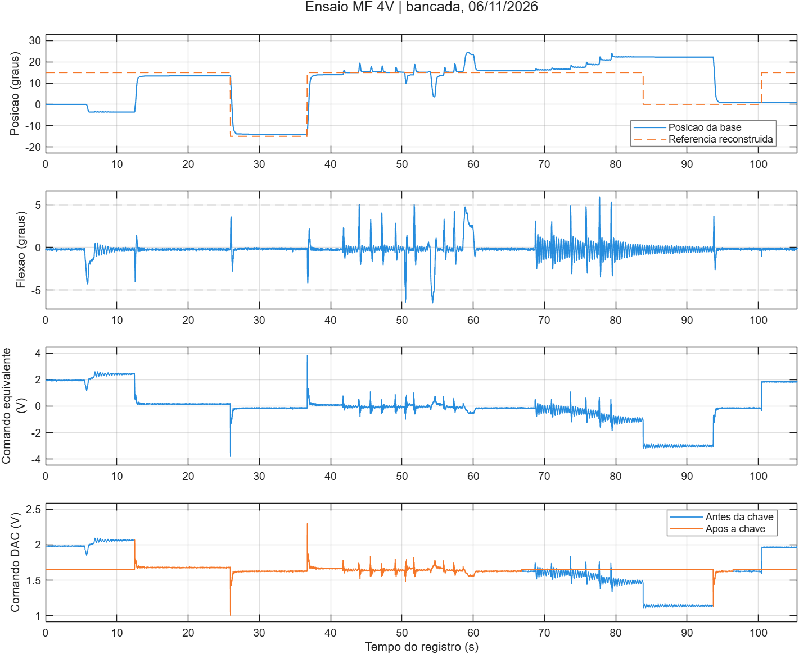

# Haste flexível — modelos e ensaios de bancada

Materiais complementares ao trabalho de graduação **Controle automático de um servomecanismo rotacional com amortecimento de vibrações estruturais**, de **Antônio Fernando Vitoriano Martines Penna**, Instituto Tecnológico de Aeronáutica, 2026.

O repositório reúne os modelos Simulink da bancada, a configuração do microcontrolador STM32 e os dados dos ensaios de **06/11/2026**. Os dados correspondem a **ensaios em malha fechada com controladores específicos avaliados na bancada** e a **ensaios em malha aberta**, com registros da posição da base, da flexão da haste e dos comandos utilizados.

## Conteúdo

```text
simulink/
├── Controle_da_Haste.slx
├── MCU_Config/
│   └── MCU_Config.ioc
└── Teste para aquisição/
    └── Teste1.slx

dados/       15 arquivos MAT com os ensaios organizados
figuras/     Exemplo das curvas de um ensaio de malha fechada
```

| Arquivo ou diretório | Descrição |
| --- | --- |
| [Controle_da_Haste.slx](simulink/Controle_da_Haste.slx) | Modelo de controle da haste, incluindo aquisição dos estados e comando do atuador. Revisão interna 1.11. |
| [Teste1.slx](simulink/Teste%20para%20aquisi%C3%A7%C3%A3o/Teste1.slx) | Modelo utilizado para aquisição e caracterização dos sinais da bancada. Revisão interna 1.87. |
| [MCU_Config.ioc](simulink/MCU_Config/MCU_Config.ioc) | Configuração dos periféricos do STM32F411 no STM32CubeMX. |
| [dados/](dados/) | Registros dos ensaios com os controladores específicos e dos ensaios em malha aberta, em estruturas numéricas MATLAB. |

Os arquivos `.gitignore` e `.gitattributes` definem o tratamento de temporários e dos formatos binários pelo Git.

## Ensaios disponíveis

Os 15 arquivos de [dados/](dados/) contêm os registros dos ensaios em malha aberta e dos ensaios com os controladores específicos, totalizando **131.289 amostras**:

| Grupo | Arquivos | Quantidade |
| --- | --- | ---: |
| Malha aberta | `MA_1V.mat`, `MA_2V.mat`, `MA_3V.mat` | 3 |
| Malha fechada — série MF | `MF_2V.mat`, `MF_3V.mat`, `MF_3p5V.mat`, `MF_4V.mat`, `MF_5V.mat`, `MF_6V.mat` | 6 |
| Malha fechada — série MF_45 | `MF_45_2V.mat`, `MF_45_3V.mat`, `MF_45_3p5V.mat`, `MF_45_4V.mat`, `MF_45_5V.mat`, `MF_45_6V.mat` | 6 |

`MA` identifica malha aberta e `MF`, malha fechada. `3p5V` corresponde ao marcador original `3V5`. O marcador `45` foi conservado para distinguir a série de origem. Os valores em volts nos nomes identificam as condições nominais dos ensaios.

### Estrutura das variáveis

Cada `.mat` contém uma única variável, `ensaio`, organizada em quatro campos:

| Campo | Conteúdo |
| --- | --- |
| `ensaio.meta` | Identificação do ensaio, origem, número de amostras e informações de amostragem. |
| `ensaio.tempo_s` | Vetor coluna com o tempo original do registro, em segundos. |
| `ensaio.sinais` | Posição, flexão, comandos e demais sinais disponíveis para aquele tipo de ensaio. |
| `ensaio.diagnostico` | Canais auxiliares de aquisição e comunicação. |

Os arrays numéricos seguem a orientação **amostras × canais**. As unidades aparecem nos nomes dos campos, como `posicao_base_deg`, `flexao_haste_deg` e `comando_calculado_v`. A composição de `sinais` e `diagnostico` depende do tipo de ensaio.

Na organização dos dados, os aliases redundantes de `logsout` foram consolidados e os objetos MATLAB foram convertidos em arrays numéricos. Nos ensaios de malha aberta, o canal originalmente chamado `EncoderRad` foi identificado como posição em graus, e a flexão foi obtida por `flexao_haste_deg = -6.7 * extensometro_v`. As amostras e os tempos dos registros foram conservados, incluindo perturbações e trechos com o controlador desligado.

## Consultar e visualizar os dados

No MATLAB, selecione a raiz deste repositório como pasta atual. O exemplo abaixo abre o ensaio de malha fechada de 4 V e exibe seus principais sinais:

```matlab
registro = load(fullfile('dados', 'MF_4V.mat'));
ensaio = registro.ensaio;
t = ensaio.tempo_s;
s = ensaio.sinais;

figure;
tiledlayout(3, 1);

nexttile;
plot(t, s.posicao_base_deg, t, s.referencia_base_deg, '--');
ylabel('Posição (graus)');
legend('Base', 'Referência');
grid on;

nexttile;
plot(t, s.flexao_haste_deg);
ylabel('Flexão (graus)');
grid on;

nexttile;
plot(t, s.comando_calculado_v);
ylabel('Comando equivalente (V)');
xlabel('Tempo (s)');
grid on;
```

Nos registros de malha fechada, `referencia_base_deg` foi reconstruída como posição menos erro de posição. `comando_calculado_v` representa a solicitação calculada ou equivalente da cadeia de atuação. Os campos `dac_antes_chave_v` e `dac_apos_chave_v` registram o comando nos dois lados da chave manual; esses sinais não constituem medição da tensão física nos terminais do motor.



## Abrir os modelos Simulink

Os dois modelos foram salvos em **MATLAB/Simulink R2025b**, em **06/11/2026**, com passo fixo de **0,01 s**.

As configurações de hardware dos modelos conservam o caminho absoluto do projeto usado no laboratório. Ao trabalhar em outro computador, atualize o campo `ProjectFile` para o caminho local de `simulink/MCU_Config/MCU_Config.ioc`.

O `.ioc` identifica **STM32F411CEUx**, **STM32CubeMX 6.17.0** e **STM32CubeIDE**. A partir dele, os projetos e as bibliotecas de suporte podem ser gerados no ambiente STM32. A geração pelo Simulink depende dos componentes correspondentes ao alvo `STM32F4xx Based` e a `ert.tlc`.

O modelo `Controle_da_Haste.slx` conserva o ganho salvo `[-3.7927 13.4423 -0.8815 0.3262]`. Os registros de bancada incluem diferentes condições de controle; esse ganho salvo não representa todas elas.
